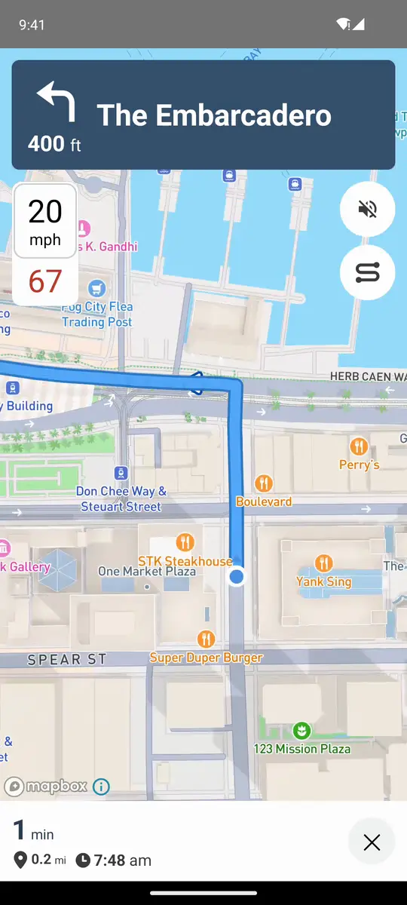

# @rnmapbox/navigation

[](https://www.npmjs.com/package/@rnmapbox/navigation) [](https://rnmapbox.github.io/docs/navigation/overview) [](LICENSE)

Turn-by-turn navigation for React Native, using the [Mapbox Navigation SDK v3](https://docs.mapbox.com/navigation/) on iOS and Android. Request routes, run active guidance with voice instructions and route progress events on your own [`@rnmapbox/maps`](https://github.com/rnmapbox/maps) `MapView`, or drop in `<NavigationView>` for the SDK's full-screen navigation UI.

<a href="https://rnmapbox.github.io/docs/navigation/overview"></a>

> Pre-1.0: APIs may still change between minor releases. CarPlay and Android Auto support is experimental.

API reference: [rnmapbox.github.io/docs/navigation/api](https://rnmapbox.github.io/docs/navigation/api).

## Why @rnmapbox/navigation

- The navigation map is a regular `@rnmapbox/maps` `MapView`: your own sources, layers, markers and camera work on it.
- A headless JS API for routes, guidance and progress events, or a drop-in UI (`<NavigationView>`, `<RNNavigationView>`).
- An Expo config plugin for [development builds](https://docs.expo.dev/develop/development-builds/introduction/) (not Expo Go), with no Podfile edits.
- No secret downloads token on iOS or Android.

Coming from another package? See [Migrating from react-native-mapbox-navigation](#migrating-from-react-native-mapbox-navigation).

## Requirements

- React Native 0.79+ with the New Architecture.
- [`@rnmapbox/maps`](https://github.com/rnmapbox/maps) >= 10.3.16, < 10.4.0 (peer dependency), see [Version pinning](#version-pinning). Navigation maps plug into its map view factory hooks (`mapViewImpl`, [rnmapbox/maps#4374](https://github.com/rnmapbox/maps/pull/4374), [#4375](https://github.com/rnmapbox/maps/pull/4375)), `<CarMap>` into their support for maps that live elsewhere ([#4412](https://github.com/rnmapbox/maps/pull/4412), [#4417](https://github.com/rnmapbox/maps/pull/4417), [#4419](https://github.com/rnmapbox/maps/pull/4419), [#4420](https://github.com/rnmapbox/maps/pull/4420); 10.3.16), and its style setters need the Maps SDK version that Navigation SDK 3.33 pins.
- iOS: React Native's minimum deployment target (15.1 for React Native 0.84; the Navigation SDK itself needs iOS 14). Mapbox Navigation SDK for iOS 3.33.0 (`MapboxNavigationCore` and `MapboxNavigationUIKit`), added as a Swift package.
- Android: `minSdkVersion` 24, `compileSdkVersion` 36. Mapbox Navigation SDK for Android 3.33.0 (`com.mapbox.navigationcore:navigation`, `ui-maps` and `ui-components`).
- A [Mapbox account](https://account.mapbox.com/auth/signup/) and a public access token (`pk.…`). Neither platform needs a secret downloads token: the Android release artifacts and the iOS Swift package binaries download without one.

Navigation is billed per trip or MAU to the access token you pass, on top of Maps usage. See [Navigation SDK pricing](https://www.mapbox.com/pricing#navigation).

## Installation

```sh
yarn add @rnmapbox/navigation @rnmapbox/maps@~10.3.16
```

### Expo

Use a [development build](https://docs.expo.dev/develop/development-builds/introduction/); Expo Go doesn't include the native SDKs.

```sh
npx expo install @rnmapbox/navigation @rnmapbox/maps@~10.3.16
```

Add both config plugins to `app.json`, with `RNMapboxMapsVersion` matching the Maps SDK the Navigation SDK pins (11.33.0, see [Version pinning](#version-pinning)); prebuild warns when they don't match:

```json
{
  "expo": {
    "plugins": [
      ["@rnmapbox/maps", { "RNMapboxMapsVersion": "11.33.0" }],
      "@rnmapbox/navigation"
    ]
  }
}
```

Then run `npx expo prebuild --clean`. On iOS the `@rnmapbox/navigation` plugin:
- sets `$RNMapboxMapsSwiftPackageManager = { link: false }` in the Podfile, see [iOS](#ios);
- adds the Navigation SDK's binary frameworks to `rnmapbox-maps`' framework search paths, which Xcode 26 needs with React Native 0.87+;
- sets `NSLocationWhenInUseUsageDescription`, unless `locationWhenInUsePermission` is `false`;
- adds `audio` to `UIBackgroundModes`: the Navigation SDK asserts in debug builds without it on any guidance start, even with voice muted;
- with `carPlay: true`, adds the CarPlay scene and the `com.apple.developer.carplay-maps` entitlement, and with `carPlayRoot: true` also hands the `AppDelegate.swift` React Native factory to CarPlay, see [CarPlay](#carplay).

On Android the `@rnmapbox/maps` plugin already adds the Mapbox Maven repository, and the Navigation SDK's manifest adds the location, foreground service and notification permissions. With `androidAuto: true` the plugin adds the Android Auto service, its metadata and the `androidx.car.app` navigation and surface permissions, see [Android Auto](#android-auto).

Options: `carPlay`, `carPlayRoot` and `androidAuto` as above, `RNMapboxNavigationVersion` sets the Navigation SDK version on both platforms (set the maps plugin's `RNMapboxMapsVersion` to the matching 11.N), and `locationWhenInUsePermission` sets the usage string. Turning `carPlay`, `carPlayRoot` or `androidAuto` off removes what they added on the next prebuild, except the entitlement and the permissions; `prebuild --clean` removes those too.

### iOS

The Navigation SDK v3 is only distributed as a Swift package. `@rnmapbox/navigation` links it, and through it MapboxMaps, into the app.
`@rnmapbox/maps` must only compile against that MapboxMaps (its compile-only Swift Package Manager mode). Otherwise the app links two copies of MapboxMaps and fails with duplicate symbols.

```ruby
# ios/Podfile, before `target`
$RNMapboxMapsSwiftPackageManager = { link: false }

target 'YourApp' do
  # ...
  pre_install do |installer|
    $RNMapboxMaps.pre_install(installer)
  end

  post_install do |installer|
    react_native_post_install(installer, ...)
    $RNMapboxMaps.post_install(installer)
  end
end
```

`pod install` adds `MapboxCommon`, `MapboxCoreMaps`, `MapboxNavigationNative` and `Turf` to the frameworks CocoaPods embeds; Xcode doesn't embed the dynamic frameworks of a package that's only linked through a pod. It uses the helper in `@rnmapbox/maps`' `ios/rnmapbox_spm.rb`.

Add `NSLocationWhenInUseUsageDescription` to your `Info.plist`, and `audio` to `UIBackgroundModes`: the SDK's voice controller asserts on it in debug builds on any guidance start, not only `<NavigationView>`.

Podfile options (set them before `use_native_modules!`):

```ruby
# Navigation SDK version, defaults to package.json `mapboxNavigation.ios`. Nav 3.N pins Maps 11.N.
$RNMapboxNavigationVersion = '3.33.0'
# Don't add the Swift package; add mapbox-navigation-ios (products MapboxNavigationCore and
# MapboxNavigationUIKit) yourself.
$RNMapboxNavigationSwiftPackageManager = 'manual'
```

`@rnmapbox/maps`' package requirement comes from `$RNMapboxMapsVersion` (default `~> 11.33.0`), and must be compatible with the Maps version the Navigation SDK pins, otherwise Xcode reports a package resolution error. With a newer Navigation SDK, set `$RNMapboxMapsVersion = '= 11.N.x'` to match.

### Android

Add the Mapbox Maven repository, the same one `@rnmapbox/maps` uses.

```groovy
// android/build.gradle
buildscript {
    ext {
        // Nav 3.33.0 pins Maps 11.33.0. Both packages must resolve the same Maps.
        RNMapboxMapsVersion = '11.33.0'
        // Optional, defaults to package.json `mapboxNavigation.android`.
        RNMapboxNavigationVersion = '3.33.0'
    }
}

allprojects {
    repositories {
        maven { url 'https://api.mapbox.com/downloads/v2/releases/maven' }
    }
}
```

`@rnmapbox/navigation` adds a strict constraint on the Maps version its Navigation SDK is built against (Nav 3.N → Maps 11.N, or `RNMapboxNavigationMapsVersion`), so a different `RNMapboxMapsVersion` fails dependency resolution instead of silently mixing versions.

With `targetSdkVersion` 35 or higher, `@rnmapbox/maps` uses the `-ndk27` Maps artifacts (16 KB pages). `@rnmapbox/navigation` applies the same rule to the Navigation artifacts, so both use the same Maps and Common artifacts. Keep `targetSdkVersion` in the root project `ext`, where both libraries read it.

### Version pinning

| @rnmapbox/navigation    | Navigation SDK | Maps SDK (pinned by Nav) | @rnmapbox/maps    |
| ----------------------- | -------------- | ------------------------ | ----------------- |
| 0.1.0+                  | 3.33.0         | 11.33.0                  | >=10.3.16 <10.4.0 |
| 0.1.0-alpha.3           | 3.33.0         | 11.33.0                  | >=10.3.12 <10.4.0 |
| 0.1.0-alpha.0 – alpha.2 | 3.23.1         | 11.23.1                  | 10.3.11           |

Navigation SDK 3.N depends on Maps SDK 11.N exactly. On Android, set `RNMapboxMapsVersion` to the matching 11.N. On iOS, `@rnmapbox/maps`' Swift package requirement must allow it.

## Getting started

Request a route, show it on a navigation map, and start simulated guidance:

```tsx
import { useEffect, useState } from 'react';
import { Text, View } from 'react-native';
import Mapbox, { Camera, MapView } from '@rnmapbox/maps';
import Navigation, {
  NAVIGATION_MAP_VIEW_IMPL,
  NavigationViewport,
  type Position,
  type Route,
  type RouteProgressEvent,
} from '@rnmapbox/navigation';

const ACCESS_TOKEN = 'pk....';
Mapbox.setAccessToken(ACCESS_TOKEN);
Navigation.setAccessToken(ACCESS_TOKEN);

const ORIGIN: Position = [-122.39726, 37.79205]; // [longitude, latitude]
const DESTINATION: Position = [-122.39351, 37.79554];

export function NavigationScreen() {
  const [progress, setProgress] = useState<RouteProgressEvent>();

  useEffect(() => {
    const subscription = Navigation.addRouteProgressListener(setProgress);
    let route: Route | undefined;
    let cancelled = false;

    Navigation.requestRoutes({ waypoints: [ORIGIN, DESTINATION] })
      .then(({ main, alternatives }) => {
        alternatives.forEach((alternative) => alternative.release());
        route = main;
        if (cancelled) {
          main.release();
          return;
        }
        // Switches the camera to 'following'.
        return Navigation.startActiveGuidance(main, { simulate: true });
      })
      .catch((error) => console.warn(error));

    return () => {
      cancelled = true;
      subscription.remove();
      Navigation.stopNavigation();
      route?.release();
    };
  }, []);

  return (
    <View style={{ flex: 1 }}>
      <MapView style={{ flex: 1 }} mapViewImpl={NAVIGATION_MAP_VIEW_IMPL}>
        <Camera defaultSettings={{ centerCoordinate: ORIGIN, zoomLevel: 14 }} />
        {/* Keeps the puck and the route clear of UI drawn over the map. */}
        <NavigationViewport
          padding={{ top: 16, bottom: 120, left: 16, right: 16 }}
        />
      </MapView>
      {progress && (
        <Text>
          {progress.maneuverInstruction} in{' '}
          {Math.round(progress.stepDistanceRemaining)} m
        </Text>
      )}
    </View>
  );
}
```

`Navigation.previewRoute(route)` shows a route on navigation maps before guidance starts, and `Navigation.setCameraState('overview')` fits the rest of the route.

### Location permission

Guidance on the device's location (without `simulate`) needs location permission:
- Android: request it at runtime before starting guidance, e.g. with `Mapbox.requestAndroidLocationPermissions()` from `@rnmapbox/maps`. The Navigation SDK's manifest already declares the permissions.
- iOS: the Navigation SDK shows the prompt itself. It needs `NSLocationWhenInUseUsageDescription` in `Info.plist`, which the Expo plugin sets.

```ts
if (Platform.OS === 'android') {
  await Mapbox.requestAndroidLocationPermissions();
}
await Navigation.startActiveGuidance(route);
```

## Migrating from react-native-mapbox-navigation

The props of [`@homee/react-native-mapbox-navigation`](https://github.com/homeeondemand/react-native-mapbox-navigation) and [`@pawan-pk/react-native-mapbox-navigation`](https://github.com/pawan-pk/react-native-mapbox-navigation) map to `<NavigationView>` (or `<RNNavigationView>`) like this:

| Their `<MapboxNavigation>`                           | `@rnmapbox/navigation`                                                             |
| ---------------------------------------------------- | ---------------------------------------------------------------------------------- |
| `origin` / `startOrigin`, `waypoints`, `destination` | `waypoints={[origin, ...stops, destination]}`, each `[longitude, latitude]`        |
| `shouldSimulateRoute`                                | `simulate`                                                                         |
| `mute`                                               | `mute`                                                                             |
| `onRouteProgressChange`                              | `onRouteProgress`                                                                  |
| `onLocationChange`                                   | `Navigation.addLocationListener`                                                   |
| `onArrive`                                           | `onArrive`, with `{ waypointIndex, isFinalDestination }`                           |
| `onCancelNavigation`                                 | `onCancel`                                                                         |
| `onError`                                            | `onError`, with `{ code, message }`                                                |
| `language`, `travelMode`                             | `requestRoutes({ waypoints, language, profile })`, then pass the result as `route` |
| `distanceUnit`                                       | `distanceUnit` on `<RNNavigationView>`, or `requestRoutes({ units })`              |

Their `.netrc` / `MAPBOX_DOWNLOADS_TOKEN` setup can go; this package doesn't need a secret token.

## API

`Navigation` is the default export and also a named export.

| Function                                     | Description                                                            |
| -------------------------------------------- | ---------------------------------------------------------------------- |
| `setAccessToken(token)`                      | Must be called before any request.                                     |
| `getSdkVersion()`                            | Version of the native Navigation SDK.                                  |
| `getDefaultDistanceUnit()`                   | `'metric'` or `'imperial'`, from the device's region and measurement settings. |
| `requestRoutes(options)`                     | `{ main, alternatives }` routes through `options.waypoints`; also `profile`, `alternatives`, `exclude`, `language`, `units`. |
| `requestMatchedRoutes(options)`              | `{ main }` route along `options.coordinates` (2 to 100), snapped to roads with Map Matching; also `profile`, `waypointIndices`, `radiuses`, `language`, `units`. Never rerouted. |
| `setRerouteEnabled(enabled)`                 | Turns rerouting of `requestRoutes` routes off or on. Android applies it at once; iOS only if called before the navigation session is created (before the first route request or guidance), and logs a warning for a later change. |
| `previewRoute(route \| null)`                | Shows a route on navigation maps, or removes it.                       |
| `startActiveGuidance(route, { simulate })`   | Starts guidance along `route`; `simulate` drives it with simulated locations. |
| `advanceToNextLeg()`                         | Guides to the next waypoint, e.g. to skip a stop.                      |
| `setAutoAdvanceLegs(enabled)`                | Whether guidance moves on by itself after arriving at a waypoint (default `true`). |
| `setSimulationSpeed(multiplier)`             | Speed of simulated guidance, e.g. `2` for twice as fast.               |
| `startFreeDrive({ simulatedLocation, foregroundService })` | Matches the location to the road without a route, ending any guidance; billed, see [Free drive](#free-drive). |
| `stopNavigation()`                           | Stops guidance or free drive and clears the maps.                      |
| `getSessionState()`                          | `'idle'`, `'freeDrive'` or `'activeGuidance'`.                         |
| `addSessionStateListener(listener)`          | Session state changes.                                                 |
| `getRouteStats()`                            | Counts of live, released and garbage-collected routes.                 |
| `setCameraState(state)` / `getCameraState()` | `'following'`, `'overview'` or `'idle'`.                               |
| `addCameraStateListener(listener)`           | Camera state changes.                                                  |
| `addRouteProgressListener(listener)`         | Distance, duration and fraction remaining, and the next maneuver's banner. |
| `addLocationListener(listener)`              | Snapped location, road name and speed limit.                           |
| `addArriveListener(listener)`                | Waypoint arrivals.                                                     |
| `addOffRouteListener(listener)`              | Leaving and rejoining the route.                                       |
| `addRouteChangeListener(listener)`           | New `Route` after a reroute or a switch to an alternative.             |
| `addVoiceInstructionListener(listener)`      | Voice instruction text and SSML.                                       |
| `setVoiceMuted(muted)` / `isVoiceMuted()`    | Mutes the SDK's voice instructions.                                    |
| `setVoiceVolume(volume)`                     | Volume of the voice instructions, 0 to 1.                              |
| `setKeepScreenOn(keepScreenOn)`              | Whether guidance keeps the screen on; on by default.                   |
| `NAVIGATION_MAP_VIEW_IMPL`                   | `mapViewImpl` value for navigation maps.                               |
| `<NavigationViewport padding />`             | Per-map camera padding.                                                |
| `<NavigationView route \| waypoints />`      | Full-screen navigation UI; see [NavigationView](#navigationview).      |
| `<RNNavigationView route \| waypoints />`    | The same UI in React Native; see [RNNavigationView](#rnnavigationview). |

### Routes

`requestRoutes` resolves to `{ main: Route, alternatives: Route[] }`. A `Route` is a JSI host object backed by the SDK route (`NavigationRoutes` on iOS, `NavigationRoute` on Android):

```ts
interface Route {
  readonly distance: number;           // meters
  readonly expectedTravelTime: number; // seconds
  readonly geometry: LineString;       // GeoJSON, a new object on every read
  readonly legs: RouteLeg[];           // { distance, expectedTravelTime, stepCount, summary, steps }
  readonly isReleased: boolean;
  release(): void;
}
```

- The getters read a copy taken when the route was created. They're synchronous and don't call into the SDK.
- `release()` frees the native route. Calling it again does nothing. Release the routes you don't keep, such as unused alternatives; the garbage collector releases the rest eventually, which can take long because it doesn't see the native memory.
- After `release()`, reading anything but `isReleased` throws an `Error` with `code: 'route_released'`, and `startActiveGuidance` and `previewRoute` reject or throw it.
- Guidance and the preview keep their own reference to the native route until `stopNavigation`. Releasing a route they use is safe and doesn't change them. Releasing can't throw, so a route the GC finalizes mid-guidance behaves the same as one released by hand.
- Each leg's `steps` are `{ instruction, distance, expectedTravelTime, maneuverType, maneuverModifier, name }`.
- `getRouteStats()` returns `{ live, released, collected }` counts, for leak checks.
- Routes don't survive a JS reload.

### Navigation maps

`<MapView mapViewImpl={NAVIGATION_MAP_VIEW_IMPL}>` is a regular `@rnmapbox/maps` map. Its props, children and events keep working. The Navigation SDK also draws the route line and the puck on it and drives its camera:
- On iOS the map is wrapped in the SDK's `NavigationMapView`.
- On Android the SDK's route line, location puck and `NavigationCamera` are bound to the map.

There's one navigation session per app. Every navigation map shows its route, puck and camera state. Without guidance the maps show the route passed to `previewRoute`.

`<NavigationViewport>` configures the map it's a child of. Its `padding` is in points from the map's edges and ignores the safe area. It applies to `following`, `overview` and the route preview. Without it the SDK defaults apply: the safe area plus a small margin on iOS, and no padding on Android.

`routeLineStyle` sets the colors of the route lines on that map. Unset colors keep the SDK's:

```tsx
<NavigationViewport
  routeLineStyle={{
    color: '#7c3aed', // main route where traffic is low or unknown
    casingColor: '#4c1d95',
    alternativeColor: '#c4b5fd',
    traveledColor: 'rgba(124, 58, 237, 0.35)', // defaults to transparent: the traveled part disappears
  }}
/>
```

The colors can change during guidance. On iOS the SDK then redraws the route, and the traveled part shows in the route color until the next location update.

### Camera

| State       | Camera                                                                    |
| ----------- | ------------------------------------------------------------------------- |
| `following` | Follows the puck, tilted and rotated with the route. Set by `startActiveGuidance`. |
| `overview`  | Fits the rest of the route.                                               |
| `idle`      | Left alone, for the user's gestures and `@rnmapbox/maps` `Camera`.        |

The state switches to `idle` when:
- a pan, pinch, rotate, pitch or double-tap gesture happens on any navigation map;
- an `@rnmapbox/maps` `Camera` moves the map from its props or `setCamera`. `defaultSettings` doesn't count;
- `stopNavigation` is called.

`addCameraStateListener` reports every change, and `getCameraState` returns the current state. Call `setCameraState('following')` to recenter.
- On Android a `Camera` move with `animationDuration: 0` doesn't switch the state, and the navigation camera takes the map back at the next location update. Animate the move, or call `setCameraState('idle')` first.
- `Camera` `followUserLocation` and the navigation camera both drive the map. Don't combine them.

After `stopNavigation`, the route and the puck are removed and the camera eases back to north-up, without tilt or padding.

### Free drive

Outside guidance the session is idle: no location events and no puck on navigation maps. `startFreeDrive()` matches the device's location to the road network without a route, so `addLocationListener` reports the road name and speed limit, and navigation maps show the puck. `stopNavigation()` ends it. During guidance, `startFreeDrive()` ends the guidance and keeps the session in free drive, as the native SDKs do.

- Mapbox bills free drive trips like guidance trips (see [Navigation SDK pricing](https://www.mapbox.com/pricing#navigation)). Nothing in this package starts free drive on its own, CarPlay included; it runs from `startFreeDrive` until `stopNavigation` or a JS reload.
- Without location permission, `startFreeDrive` rejects with `code: 'location_permission'`. Ask for the permission first.
- `startFreeDrive({ simulatedLocation: [longitude, latitude] })` parks a simulated device at that position instead, without location permission. After simulated guidance, `startFreeDrive()` keeps the simulated device where guidance stopped.
- Android: free drive runs without the Navigation SDK's foreground service, so in the background Android throttles its location updates. `startFreeDrive({ foregroundService: true })` keeps tracking in the background with the SDK's notification, which also keeps the billed trip going while the app isn't visible, until `stopNavigation`. Live guidance always uses the foreground service. iOS ignores the option.
- `<NavigationView>` and `<RNNavigationView>` started from free drive return to it when they unmount or the user ends the trip, as `startFreeDrive()` would, keeping the `foregroundService` option.
- `getSessionState()` and `addSessionStateListener` report `idle`, `freeDrive` or `activeGuidance`. On iOS they follow the SDK's session; on Android they follow this package's calls.

```ts
await Navigation.startFreeDrive();
const subscription = Navigation.addLocationListener(({ roadName, speedLimit }) =>
  console.log(roadName, speedLimit?.speed, speedLimit?.unit)
);
// …
subscription.remove();
Navigation.stopNavigation();
```

### Guidance events

- `addRouteProgressListener`: distances and durations remaining, and the banner of the next maneuver: `maneuverInstruction`, `maneuverType`, `maneuverModifier`, `secondaryInstruction`, `subInstruction`, `lanes` (`{ indications, valid, activeDirection }`, left to right), `legIndex` and `stepIndex`.
- `addLocationListener`: during guidance and free drive, the location snapped to the road or route, with `speed`, `course`, `roadName` and `speedLimit` (`{ speed, unit: 'km/h' | 'mph', sign: 'mutcd' | 'vienna' }`) where known.
- `addArriveListener`: `{ waypointIndex, isFinalDestination }` when a waypoint is reached.
- `addOffRouteListener`: `true` when the user leaves the route, `false` once guidance follows a route again.
- `addRouteChangeListener`: `{ route, reason }` when guidance switches routes on its own, `reason` being `reroute` or `alternative`. `route` is a new `Route`; release it when you're done. The previous route stays valid until released.
- `addVoiceInstructionListener`: `{ text, ssml, distanceAlongStep }` when an instruction is due, for apps doing their own text to speech.

The SDK speaks instructions during any guidance. `setVoiceMuted(true)` mutes it, including in `<NavigationView>`.

Guidance keeps the screen on, including in `<NavigationView>`, and puts back the app's own idle timer (iOS) or keep screen on (Android) setting when it stops. `setKeepScreenOn(false)` turns that off for apps that manage it themselves.

### NavigationView

`<NavigationView>` is a full-screen navigation UI: `NavigationViewController` from `MapboxNavigationUIKit` on iOS, and an equivalent built from the Navigation SDK UI components on Android (maneuver banner with lanes and shields, speed limit, trip progress, mute, overview, recenter and end buttons).

```tsx
import { NavigationView } from '@rnmapbox/navigation';

<NavigationView
  style={{ flex: 1 }}
  waypoints={[[-122.39726, 37.79205], { coordinate: [-122.39351, 37.79554], name: 'Ferry Building' }]}
  simulate
  mute={muted}
  onRouteProgress={(event) => console.log(event.distanceRemaining)}
  onArrive={({ waypointIndex, isFinalDestination }) => {}}
  onCancel={() => close()}
  onError={({ code, message }) => {}}
/>
```

| Prop              | Description                                                                         |
| ----------------- | ----------------------------------------------------------------------------------- |
| `route`           | A `Route` from `requestRoutes`. Keep it unreleased while it's passed to the view.   |
| `waypoints`       | Used without `route`: the view requests a route through them and releases it on unmount. |
| `simulate`        | Drives the route with simulated locations. Read when guidance starts.               |
| `mute`            | Mutes voice instructions. The view's own mute button also toggles them.             |
| `styleURL`        | Map style by day. Defaults to Mapbox Standard.                                      |
| `nightStyleURL`   | Map style at night, i.e. while the system is in dark mode. Defaults to `styleURL`, or without it to Standard's night preset. |
| `onRouteProgress` | Same event as `addRouteProgressListener`.                                           |
| `onArrive`        | `{ waypointIndex, isFinalDestination }`; `waypointIndex` counts the origin as 0.    |
| `onCancel`        | The user ended the trip. Guidance has stopped; unmount the view.                    |
| `onError`         | `{ code, message }`, e.g. `route_request_failed`, `route_released`, `start_failed`. |

It uses the app's single navigation session:
- Mounting it, or giving it a new route, starts guidance along that route and replaces any other active guidance. Navigation maps show its route and puck too.
- Unmounting it, or the user ending the trip, stops guidance. If guidance started from free drive, the session returns to free drive instead.
- `addRouteProgressListener` and `addCameraStateListener` also report its guidance.
- Show one `NavigationView` at a time. On iOS it's embedded as a child of the nearest view controller.

### RNNavigationView

`<RNNavigationView>` is the same kind of navigation UI written in React Native on top of the API above: a navigation map plus a maneuver banner with road shields, exit numbers and lanes, a speed limit sign, the road name, ETA and remaining time and distance, mute, overview/recenter and end buttons, and an arrival card. It takes the same props as `<NavigationView>`, plus:

- `distanceUnit`: `'metric'` or `'imperial'`, for the distances it shows and the voice instructions of a route it requests through `waypoints`. Defaults to `getDefaultDistanceUnit()`.
- `appearance`: `'auto'` (default) is `'night'` while the system is in dark mode, like `<NavigationView>`; the UI and the Standard style's light preset follow it.
- `styleURL`, defaulting to Mapbox Standard. With another style, `appearance` only changes the UI. `nightStyleURL` replaces it while `appearance` is night.
- `routeLineStyle`, the same as `<NavigationViewport>`'s.
- `children`, rendered inside its `MapView`.

With `waypoints` it also requests alternative routes. Navigation maps draw the alternatives of the active guidance, and tapping one switches guidance to it, which `addRouteChangeListener` reports with `reason: 'alternative'`.

Use it as is, or copy it as a starting point for your own UI.

### CarPlay

Experimental, iOS only. With the Expo plugin's `carPlay: true`, CarPlay shows the Navigation SDK's own CarPlay UI for the same navigation session as the phone: the map while idle, and turn-by-turn guidance while guidance runs. Ending the trip on CarPlay stops navigation. The map only shows the puck during guidance and free drive; unlike the SDK's default, connecting CarPlay doesn't start free drive, so the CarPlay map has no puck until the app calls `Navigation.startFreeDrive()`, e.g. from `addCarPlayConnectionListener`. The free drive the SDK starts after the end-of-route feedback is stopped too, unless the app had started free drive. `Navigation.isCarPlayConnected()` and `Navigation.addCarPlayConnectionListener` report the connection.

- It needs the scene-based life cycle, which Expo SDK 58 apps have. Bare apps add the CarPlay scene to `UIApplicationSceneManifest` themselves, with `RNMBXNavigationCarPlaySceneDelegate` as its delegate class.
- CarPlay can launch the app without its phone UI. Set `MBXAccessToken` in Info.plist so the map shows right away; otherwise CarPlay stays blank until JS calls `Navigation.setAccessToken`.
- Ask for location permission in the phone UI. CarPlay can't show the prompt, so on a CarPlay-only first launch the map has no puck or location until the user allows it on the phone.
- The app needs the `com.apple.developer.carplay-maps` entitlement (the plugin adds it) and an `application-identifier`, which code signing adds. Running on a device or in a car needs Apple to grant the CarPlay navigation entitlement to your team; the iOS Simulator (I/O › External Displays › CarPlay) doesn't.
- In the iOS 26.4 and 26.5 simulators, CarPlay's host process crashes as soon as a map template appears, an Apple bug (see [mapbox-navigation-ios#4827](https://github.com/mapbox/mapbox-navigation-ios/issues/4827)). For development, `scripts/carplay-simulator-shim/shim.sh inject <UDID>` injects a stub into that simulator's CarPlay host, and `shim.sh cleanup <UDID>` removes it. It only affects the simulator and is not part of the package.

### CarMap

`<CarMap>` adds its `@rnmapbox/maps` children (sources, layers, images) to the car screen's map, on CarPlay and Android Auto. Its children can be a function of `activity` (`"browsing"` or `"navigating"`); it remounts them whenever the car screen switches maps, e.g. when guidance starts.

On iOS, also register it as the CarPlay root. That root stays mounted while CarPlay is connected and starts React Native when CarPlay launches the app without its phone UI. It needs the plugin's `carPlayRoot: true`, or `RNMBXNavigationCarPlayRoot.reactNativeFactory = factory` in a bare app's delegate. While the root is mounted, `<CarMap>` elsewhere in the app renders nothing, so the same component can go in both places:

```tsx
// index.ts: CarPlay looks the root up before anything else loads.
registerRootComponent(App); // App renders <CarMapLayers /> for Android Auto
Navigation.registerCarPlayRoot(CarMapLayers);

function CarMapLayers() {
  return (
    <CarMap>
      <ShapeSource id="stops" shape={stops}>
        <CircleLayer
          id="stops"
          style={{ circleColor: '#d946ef', circleEmissiveStrength: 1 }}
        />
      </ShapeSource>
    </CarMap>
  );
}
```

- The navigation styles light the map at night; set `circleEmissiveStrength` (and the other `*EmissiveStrength` properties) to 1 to keep colors.
- After CarPlay started React Native, a phone cold start from a link doesn't reach `Linking.getInitialURL()`: the React Native host already exists, without the phone scene's launch options. The `url` event still fires for links that arrive later.

### Android Auto

Experimental. With the plugin's `androidAuto: true`, Android Auto shows a navigation map for the same session as the phone, following the location while guidance runs, and `<CarMap>` adds to it. Guidance is reported to Android Auto's `NavigationManager`, so Android Auto knows a trip is running and ending it there stops guidance. It isn't a complete navigation app yet: no trip updates or turn-by-turn templates, and it hasn't been tested on a head unit. Android Auto starts no JS of its own, so `<CarMap>` renders once the app's React Native is running.

In debug builds, a car screen preview helps without a head unit:

```sh
adb shell am broadcast -a com.rnmapbox.navigation.DEBUG_CAR_PREVIEW --ez show true \
  --ef latitude 37.789 --ef longitude -122.403 --ef zoom 15 --ez follow false
```

## Example app

`example/` (React Native 0.84.1) has a navigation map with route preview, simulated guidance, camera states and a simulated free drive toggle showing the road name and speed limit, a "Route lifecycle" screen with `Route` checks and live counts, a "NavigationView" screen with simulated guidance, and a "RNNavigationView" screen with the React Native UI, simulated or on the device's location, and a log of arrival, off-route, reroute and voice events, a "Markers" screen with `@rnmapbox/maps` markers, a `ShapeSource` of points of interest, custom route line colors and React Native map controls during simulated guidance, and a "Matched route" screen that matches a fixed tour along the Embarcadero and simulates guidance along it.

It reads your Mapbox access token from `example/accesstoken` (gitignored), the same way the `@rnmapbox/maps` example does:

```sh
nvm use                                  # Node 22.16.0
echo "pk...." > example/accesstoken
yarn                                     # writes example/env.json from accesstoken

yarn example start
yarn example ios                         # pod install runs automatically
yarn example android
```

The Expo example uses the same token; `expo-example/accesstoken` overrides it:

```sh
cd expo-example
npx expo prebuild --clean
npx expo run:ios
npx expo run:android
```

## Known limitations

- No explicit offline routing API. Requests use the SDK's default hybrid router, which only falls back to onboard routing with routing tiles already on the device.
- Android `<NavigationView>` has no end-of-route or feedback UI, no night colors for its UI (only the map switches), no road name label, and doesn't show reroutes as such.
- `<RNNavigationView>` draws road shields from the Directions API's shield images, not the Mapbox designed shields the native banners use.
- The Expo config plugin is only tested with Expo SDK 58.
- `@rnmapbox/maps` `LocationPuck` and `UserLocation` don't work on navigation maps: the navigation puck replaces the map's location provider.
- One navigation session for all navigation maps. Per-map routes or cameras aren't supported.
- Route progress events already on their way to JS still arrive after `stopNavigation`. Ignore them if you need to.
- Not tested yet: live (non-simulated) guidance on a device, release builds, several navigation maps at once, and unmounting a map during guidance.

## Development

```sh
yarn lint
yarn typecheck
yarn test
yarn prepare   # builds lib/ with react-native-builder-bob
yarn docs      # API reference into docs/api/, see below
```

The API reference is generated from the JSDoc in `src/` with TypeDoc and `typedoc-plugin-markdown`. On each published release, `.github/workflows/update-docs.yml` regenerates it from the release tag into `docs/navigation/api/` of [rnmapbox/maps-docs](https://github.com/rnmapbox/maps-docs).

See [CONTRIBUTING.md](CONTRIBUTING.md).

## License

`@rnmapbox/navigation` is [MIT](LICENSE) licensed.

- The Mapbox Navigation SDKs for iOS and Android it builds on are proprietary. Their use is governed by the [Mapbox Terms of Service](https://www.mapbox.com/legal/tos) and [Navigation SDK pricing](https://www.mapbox.com/pricing#navigation). They're dependencies and aren't redistributed here.
- You need a Mapbox account and access token to use them.
- This is a community-maintained package, not an official Mapbox product.
